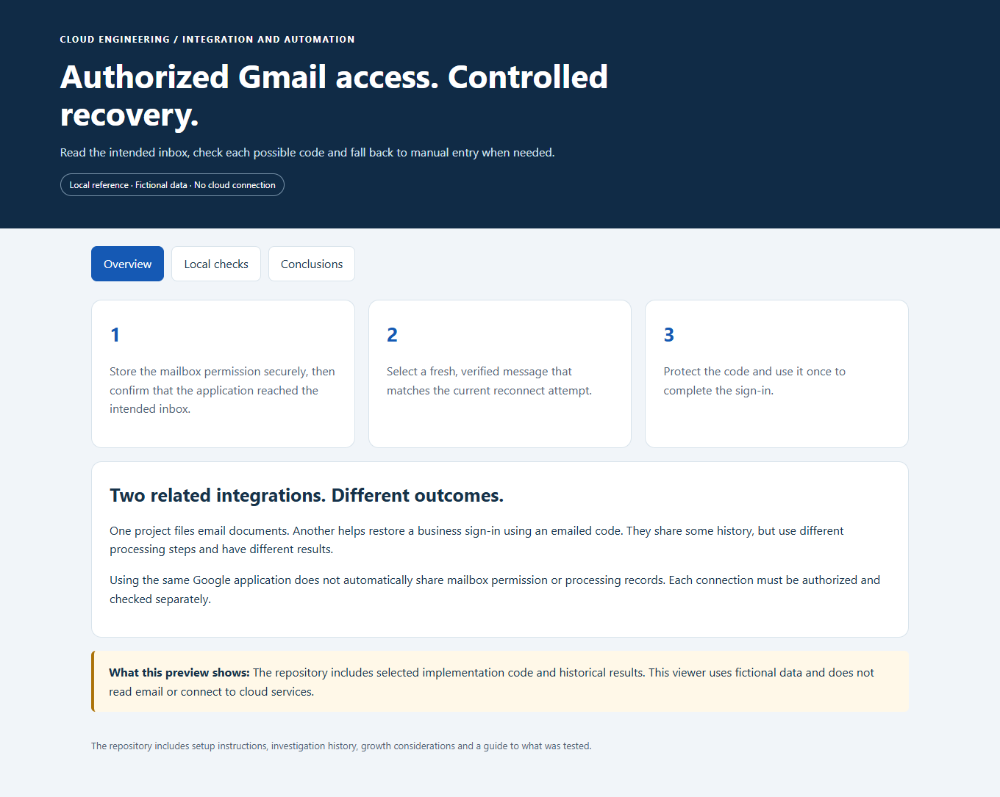
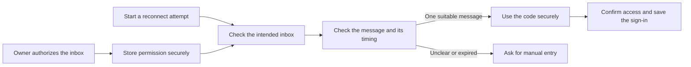
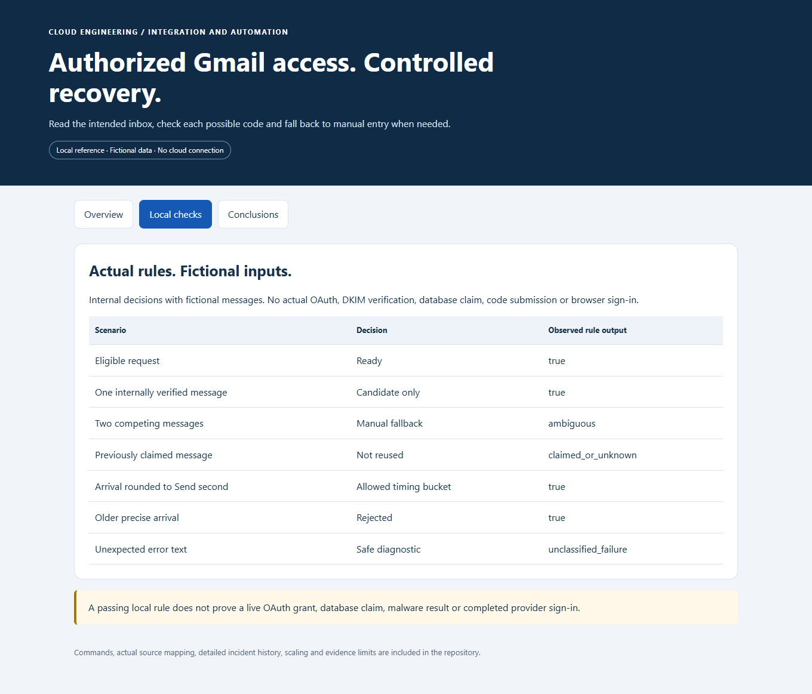
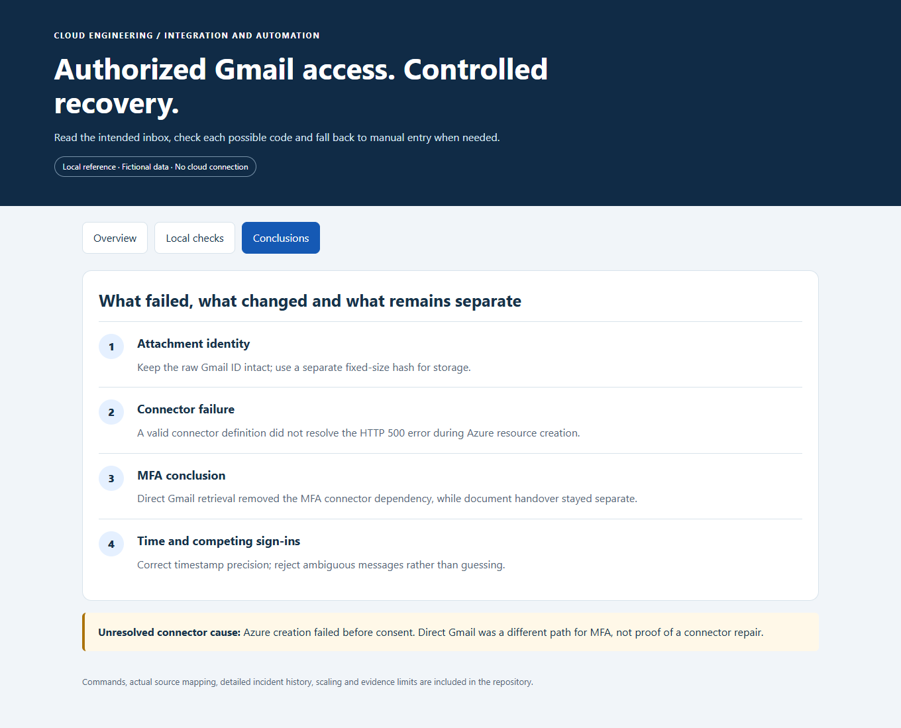

# Gmail API Access and Provider MFA Recovery

**Help restore a business connection using the right email verification code, with manual help when needed.**

[Business problem](#the-business-problem) · [Solution](#the-solution) · [Conclusions](#why-direct-gmail-access) · [Proof](#proof-it-works) · [Commands](docs/COMMANDS.md) · [Step by step](#step-by-step)



## The Business Problem

The workforce platform imports operational reports from an external service. When its saved connection requires a new email verification code, imports can stop until an operator notices the failure, checks the mailbox and completes reconnection. That leaves the platform working with older imported information while recovery is pending.

Simply reading the newest code is unreliable. An older message, a code generated by a regular browser sign-in or an unrelated verification attempt can be mistaken for the current request. Access to the mailbox also needs tighter handling than copying its messages or credentials into application logs.

The business need was to assist recovery of the intended connection using the authorized inbox, recognize uncertain matches and preserve a manual fallback when the correct code cannot be established safely.

## The Solution

I used Google's Gmail API—the supported interface for programs to read Gmail—to check an authorized inbox. The application verifies the account and message, then passes a suitable code securely to the component handling the sign-in.

The mailbox owner grants permission through Google. The saved authorization is protected in Azure Key Vault, a service for storing secrets. When messages are unclear or the request has expired, the process falls back to manual entry.

**Business outcome:** The platform has a controlled way to recover the connection without depending entirely on staff watching the inbox. It still needs manual help in some cases.

MFA means multi-factor authentication: an extra verification step beyond the initial sign-in. In this case, that step uses an emailed code.

## Tools Used and What They Do

| Tool or service | What it does | Where it fits |
| --- | --- | --- |
| Gmail API | Enumerate and retrieve candidate verification messages. | Actual direct-access integration, not a dependency on the failed Logic Apps connector. |
| Google OAuth 2.0 | Authorize the established mailbox and support credential renewal. | Actual authorization protocol; the local fixtures do not repeat consent. |
| Azure Key Vault and managed identity | Protect and retrieve the selected Google authorization material. | Actual credential boundary; no tokens or codes are included. |
| Azure Functions, Node.js and TypeScript | Bound lookup work, validate candidate metadata and coordinate the recovery request. | Selected actual implementation; local tests use fake provider responses. |
| Playwright and Chromium | Handle the provider browser sign-in and consume the accepted code command. | Downstream worker context; this repository does not run a real provider reconnect. |
| Node test runner and Python | Run transport/parser checks and the local explanatory preview. | Public local validation, separate from live inbox or browser acceptance. |

The Gmail API retrieves a candidate message; it does not by itself complete provider sign-in. Mailbox identity, browser challenge, freshness, ambiguity and saved session remain separate checks.

## Step by Step

Your own read-only Gmail OAuth application and a message-selection check that does not expose verification codes.

[Open the standalone build guide](docs/BUILD-YOUR-OWN.md) or follow the same complete instructions below.

Start with a new folder, your own files and your own accounts. The numbered steps below describe the build; no portfolio repository checkout is required. The existing implementation/evidence elsewhere in this repository is a separate reference, not a claim that your new build has already passed.

### Prerequisites

A Google Cloud project you control, a test Gmail inbox, Python and permission to configure OAuth consent. This first build reads message metadata only; it does not automatically submit an MFA code or sign in to another service.

Use Bash on Linux/macOS/WSL for Bash blocks and PowerShell for PowerShell blocks. Select the tool versions supported by the official sources below, record the versions you actually install and retain generated dependency locks. Cloud resources, scanner downloads, logs and external AI calls can create costs; review the stated scope before enabling them.

### Create your project folder

Choose a new folder name. These first commands create a blank project; an optional `git init` gives it its own history. Create parent directories in your editor when a later step introduces a nested file.

```bash
mkdir my-gmail-api-access-and-mfa-recovery
cd my-gmail-api-access-and-mfa-recovery
git init
```

Create `.gitignore` before saving credentials or build outputs:

```gitignore
.venv/
node_modules/
.env
.env.*
local.settings.json
credentials.json
token.json
*.pem
*.key
*.tfstate*
*.tfplan
.terraform/
private*/
captures/
backups/
batch.json
reports/
out/
app-config.local.yaml
```

The source/file snippets are a starting implementation you type or paste into the named files. Replace `YOUR_*`, names, regions and addresses only with values from your own lab; do not place real client/employee records in a test project. Keep your terminal in this project root unless a step explicitly changes directory.

Before a first commit, set your own repository-local author with `git config user.name "YOUR_NAME"` and `git config user.email "YOUR_PUBLIC_COMMIT_EMAIL"`. Review `git status --short` and the staged diff before publishing; ignored local files are not a substitute for reviewing what you upload.

### Step 1 — Enable your own API and consent application

**Where:** Google Cloud Console → APIs & Services; Google Auth Platform.

Enable Gmail API in your project. Configure the consent app's branding/audience and authorized test user, choosing the actual mailbox you intend to read; publishing/verification and refresh-token behavior must be reviewed before unattended use.

**Check before continuing:** The project has Gmail API enabled and the intended user may consent.

### Step 2 — Create a desktop OAuth client

**Where:** Google Auth Platform → Clients.

Create a Desktop app client and download its client configuration privately as credentials.json. Keep it outside Git and use a regular browser for consent; do not reuse the portfolio project's client IDs or secrets.

**Check before continuing:** Your own desktop client file is available privately.

### Step 3 — Install your reader dependencies

**Where:** Your new project folder.

Create a virtual environment and install the Google API/OAuth libraries. Record the resolved dependencies in a lock file for your own implementation.

```bash
python3 -m venv .venv
.venv/bin/python -m pip install google-api-python-client google-auth-oauthlib
.venv/bin/python -m pip freeze > requirements.lock.txt
```

**Check before continuing:** The selected interpreter can import the API and OAuth helpers.

### Step 4 — Write the first read-only call

**Where:** Your project folder.

Create reader.py below and privately configure EXPECTED_GMAIL_ADDRESS to the primary address of your intended test inbox before running it. The profile check happens before listing messages; the script saves no refresh token and prints neither the address nor a message body/code.

Create **`reader.py`** with the following contents:

```python
import os
from google_auth_oauthlib.flow import InstalledAppFlow
from googleapiclient.discovery import build
expected = os.environ.get('EXPECTED_GMAIL_ADDRESS', '').strip()
if not expected or '@' not in expected:
    raise ValueError('Set the intended primary Gmail address privately before authorizing')
SCOPES = ['https://www.googleapis.com/auth/gmail.readonly']
flow = InstalledAppFlow.from_client_secrets_file('credentials.json', SCOPES)
credentials = flow.run_local_server(port=0)
gmail = build('gmail', 'v1', credentials=credentials)
profile = gmail.users().getProfile(userId='me').execute()
actual = profile.get('emailAddress') if isinstance(profile, dict) else None
if not isinstance(actual, str) or actual.casefold() != expected.casefold():
    raise RuntimeError('Authorized mailbox does not match the intended primary account; no messages were read')
result = gmail.users().messages().list(userId='me', q='newer_than:1d', maxResults=5).execute()
print({'mailbox_verified': True, 'returned_messages': len(result.get('messages', []))})
```

**Check before continuing:** The code asks only for Gmail read access and reports a bounded message count.

### Step 5 — Authorize and verify the exact mailbox

**Where:** Your terminal and regular browser.

Authorize the intended test inbox in your regular browser and confirm mailbox_verified is true. If the primary account does not match, stop and revoke any unintended consent through that Google account's connected applications before retrying; do not change the expected address just to bypass the mismatch.

```bash
read -r -p 'Expected primary Gmail address: ' EXPECTED_GMAIL_ADDRESS
export EXPECTED_GMAIL_ADDRESS
.venv/bin/python reader.py
```

Enter the intended account's primary address at the private prompt; this avoids putting its literal value into the command history. An alias can differ from the primary profile address. Keep the terminal and callback URLs out of public screenshots.

**Check before continuing:** Your own OAuth client can read the intended account.

### Step 6 — Design MFA selection and fallback

**Where:** Your own protected adapter.

Before using messages for recovery, bind the mailbox to one provider account and match sender authentication, recipient, request time and template; reject ambiguous candidates and regular-browser sign-in codes. Store refresh credentials in a protected vault, serialize reconnect attempts and retain manual fallback rather than repeatedly requesting paid/provider operations.

**Check before continuing:** Automatic recovery has an explicit identity/time contract and remains disabled until that separate flow is accepted.

### Step 7 — Remove access when finished

**Where:** Google account → Security → connected applications.

Revoke your lab consent if it will not be used and remove local client/token material under your retention policy. Retain only a value-free diagram and evidence of the read-only request.

**Check before continuing:** No mailbox credential or code is published.

### Verification and your own screenshots

| Evidence | What to record | Your result |
| --- | --- | --- |
| New build | Your own files/resource settings and tool versions | Not yet recorded |
| Working path | The actual successful request, configuration or recovery result | Not yet recorded |
| Failure boundary | A meaningful denied, malformed, stale or failed case | Not yet recorded |
| Recovery / cleanup | What you restored or removed and what remains billed | Not yet recorded |

Capture your own architecture/configuration, one working result and one failure/recovery result. Keep tokens, credentials, personal records and private identifiers out of public screenshots. Existing portfolio images are references, not evidence that you performed these steps.

### Troubleshooting order

1. Confirm the named file, working directory and selected tool/interpreter.
2. Check the exact input and resource/account selected for the failing step.
3. Separate identity permission, network/DNS reachability and application validation.
4. Keep the actual error and reconcile an unknown write outcome before repeating it; do not widen access or repeat paid operations blindly.

The numbered steps describe a build procedure. Local syntax checks, an accepted API request, a completed hosted operation and a human verification are different evidence levels; fill in the verification table with what you actually observed.

### Official implementation references

- [developers.google.com — python](https://developers.google.com/workspace/gmail/api/quickstart/python)
- [developers.google.com — oauth2](https://developers.google.com/identity/protocols/oauth2)
- [developers.google.com — getProfile](https://developers.google.com/workspace/gmail/api/reference/rest/v1/users/getProfile)

The walkthrough layout follows the prerequisites → creation/configuration → test → verification → troubleshooting → cleanup pattern of the [Splunk project reference](https://github.com/davidharris6/splunk-siem-log-analysis). Its Splunk-specific settings are not copied into unrelated projects.

<details>
<summary>Reference: how the existing platform implementation operates</summary>

A short walkthrough of the process, with technical instructions and evidence limits in the sections below.

1. **Authorize the intended inbox (Google OAuth 2.0)** — The mailbox owner grants permission through Google. The application stores that authorization securely and confirms the mailbox account before reading.

2. **Look for the current code (Gmail API)** — A reconnect attempt searches a limited set of recent messages. Sender checks, message timing and competing emails help determine whether one code is suitable.

3. **Complete the sign-in securely (Playwright worker)** — The application prevents reuse and protects the code before passing it to the sign-in component. It confirms access to protected provider pages before saving the session.

4. **Use manual help when needed** — An expired or unclear result falls back to manual entry instead of guessing. Reusing an already valid saved sign-in is tracked separately from completing a new email challenge.

</details>

## Architecture



## What Was Built

| Part | What it does | Details |
| --- | --- | --- |
| Gmail connection | Reads only approved Google service addresses and checks the mailbox account. | [Connection code](src/gmailTransport.ts) |
| Message selection | Limits the search and rejects old, duplicate or competing messages. | [Selection rules](src/mailbox/mailbox-candidate.js) |
| Timing correction | Handles an email time rounded to whole seconds without generally allowing older codes. | [Timing rules](src/mailbox/candidate-binding.js) |
| Protected code handling | Verifies the email, prevents reuse and encrypts the code before handing it over. | [Verification](reference/gmailMessage.ts) and [storage](reference/gmailLookupStore.ts) |
| Manual fallback | Leaves uncertain cases for a person instead of guessing. | [Operating guide](docs/OPERATIONS-AND-SCALING.md) |

## Why Direct Gmail Access?

An earlier attempt used an Azure connector, a service that links applications. Its definition passed validation, but Azure returned HTTP 500 while creating it, before mailbox access could begin. The underlying service cause was not established.

Direct Gmail access avoided that connector for the sign-in recovery process. It did not fix the separate [email document-ingestion project](https://github.com/truthofsource/azure-logic-apps-document-ingestion). Reusing the same Google project does not share mailbox permissions or prove both integrations work.

## Proof It Works

**27 recorded local tests passed** using fictional emails and simulated Google responses. They checked the account restrictions, search limits and message-selection rules.

Historical operating records also describe a corrected reconnect and reuse of the saved sign-in. The local examples do not repeat a real mailbox connection or live sign-in. [Results and limits](docs/VALIDATION.md).

<details>
<summary>For engineers: detailed results, examples and commands</summary>

### 1. Run local transport and selection checks

```bash
npm test
npm run demo
```

**Observed: 27 local code tests passed, with zero failures.** Tests use fake HTTP responses and fictional messages. They exercise actual transport and helper code without using a real Google account. These local tests do not repeat live Google consent, email-authenticity checks, database writes or browser sign-in.



### 2. Review the difficult cases



Multiple fresh messages remain ambiguous, even when their codes match. Regular browser sign-ins can create competing emails. The code does not guess which one belongs to the worker.

### 3. Open the local reference

```bash
python -B scripts/preview.py --port 8141
```

Open [the local reference](http://127.0.0.1:8141). No real messages, codes, OAuth credentials or account data are displayed. [Validation](docs/VALIDATION.md) separates local checks from dated platform acceptance.

</details>

## Strengths, Weaknesses and Tradeoffs

| Benefit | What still needs attention |
| --- | --- |
| Avoids the failed connector dependency | The application must handle permission renewal and Google service errors. |
| Does not edit or send email through this permission | Read-only access still allows the application to read the authorized mailbox. |
| Rejects unclear messages | Two suitable messages may require manual entry, even if they contain the same code. |
| Protects codes and prevents reuse | The database, encryption keys and sign-in component must work together. |

For more accounts or more frequent reconnects, measure delays, service limits and manual fallbacks first. Keep each account's requests separate. [Growth and operations](docs/OPERATIONS-AND-SCALING.md).

## Guides

- [Access, verification and identity boundaries](docs/IMPLEMENTATION.md)
- [Issues and conclusions](docs/ISSUES-AND-CONCLUSIONS.md)
- [Commands and clickops](docs/COMMANDS.md)
- [Operations, costs and scaling](docs/OPERATIONS-AND-SCALING.md)
- [Source map](docs/SOURCE-MAP.md)
- [Validation and evidence limits](docs/VALIDATION.md)

Identifying organization and provider labels are generalized. The historical connector stays Off; it is not part of the working direct-API dependency chain. Publication performs no Gmail reads, code requests, Azure starts or deployments. GitHub checks are manual-only.
