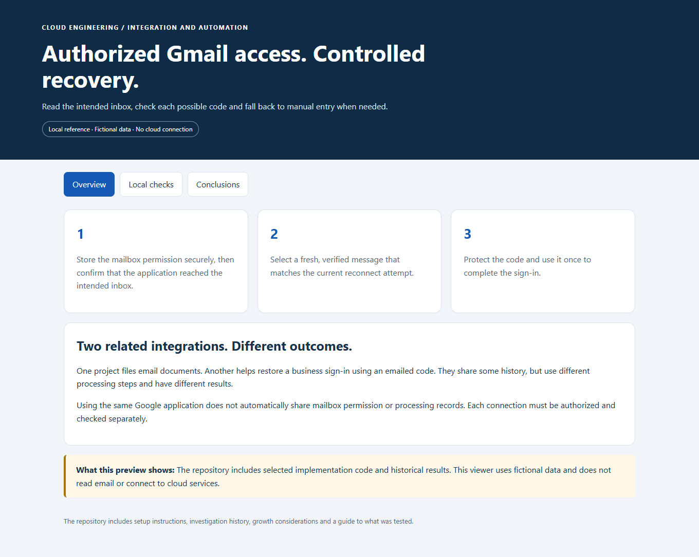
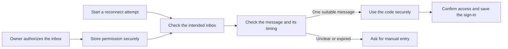
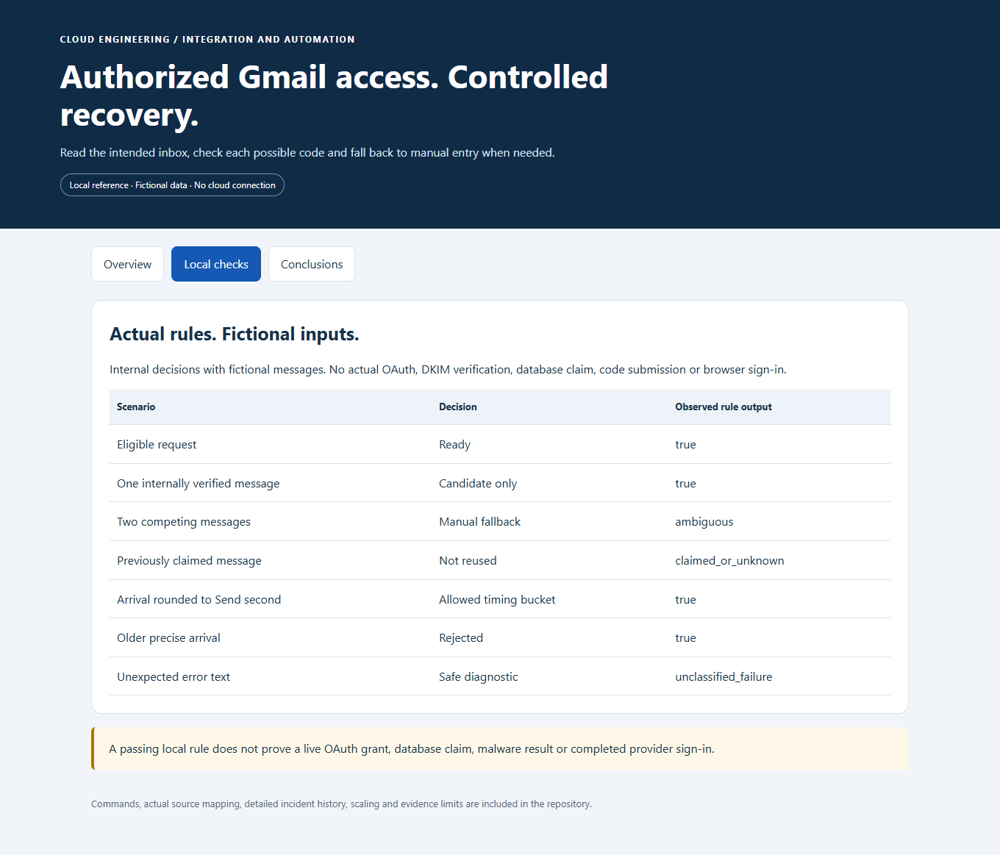
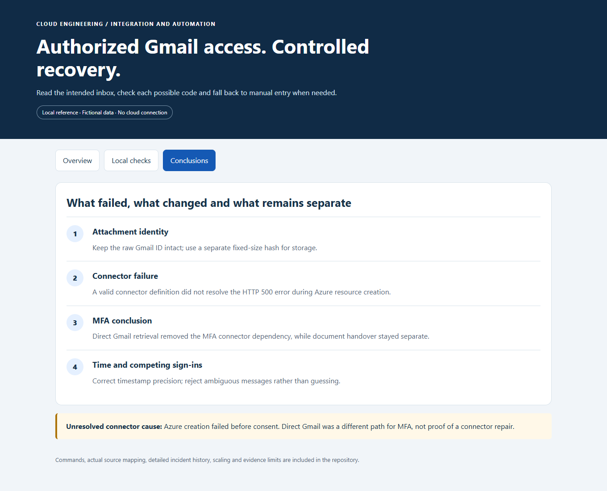

# Gmail API Access and Provider MFA Recovery

**Help restore a business connection using the right email verification code, with manual help when needed.**

[Business problem](#the-business-problem) · [Solution](#the-solution) · [Conclusions](#why-direct-gmail-access) · [Proof](#proof-it-works) · [Commands](docs/COMMANDS.md) · [Step by step](#step-by-step)



## The Business Problem

The platform imports reports from an external business service. Sometimes its saved sign-in stops working and the service emails a verification code. Staff then have to notice the failure and reconnect.

Automating that step requires care: an older code, a message for another account or a code from a separate browser sign-in could be the wrong one.

## The Solution

I used Google's Gmail API—the supported interface for programs to read Gmail—to check an authorized inbox. The application verifies the account and message, then passes a suitable code securely to the component handling the sign-in.

The mailbox owner grants permission through Google. The saved authorization is protected in Azure Key Vault, a service for storing secrets. When messages are unclear or the request has expired, the process falls back to manual entry.

**Business outcome:** The platform has a controlled way to recover the connection without depending entirely on staff watching the inbox. It still needs manual help in some cases.

MFA means multi-factor authentication: an extra verification step beyond the initial sign-in. In this case, that step uses an emailed code.

## Tools Used and What They Do

| Tool or service | What it does | Where it fits |
| --- | --- | --- |
| Gmail API | Enumerate and retrieve candidate verification messages. | Actual direct-access integration, not a dependency on the failed Logic Apps connector. |
| Google OAuth 2.0 | Authorize the established mailbox and support credential renewal. | Actual authorization protocol; the local fixtures do not repeat consent. |
| Azure Key Vault and managed identity | Protect and retrieve the selected Google authorization material. | Actual credential boundary; no tokens or codes are included. |
| Azure Functions, Node.js and TypeScript | Bound lookup work, validate candidate metadata and coordinate the recovery request. | Selected actual implementation; local tests use fake provider responses. |
| Playwright and Chromium | Handle the provider browser sign-in and consume the accepted code command. | Downstream worker context; this repository does not run a real provider reconnect. |
| Node test runner and Python | Run transport/parser checks and the local explanatory preview. | Public local validation, separate from live inbox or browser acceptance. |

The Gmail API retrieves a candidate message; it does not by itself complete provider sign-in. Mailbox identity, browser challenge, freshness, ambiguity and saved session remain separate checks.

## Step by Step

A short walkthrough of the process, with technical instructions and evidence limits in the sections below.

1. **Authorize the intended inbox (Google OAuth 2.0)** — The mailbox owner grants permission through Google. The application stores that authorization securely and confirms the mailbox account before reading.

2. **Look for the current code (Gmail API)** — A reconnect attempt searches a limited set of recent messages. Sender checks, message timing and competing emails help determine whether one code is suitable.

3. **Complete the sign-in securely (Playwright worker)** — The application prevents reuse and protects the code before passing it to the sign-in component. It confirms access to protected provider pages before saving the session.

4. **Use manual help when needed** — An expired or unclear result falls back to manual entry instead of guessing. Reusing an already valid saved sign-in is tracked separately from completing a new email challenge.

## Architecture



## What Was Built

| Part | What it does | Details |
| --- | --- | --- |
| Gmail connection | Reads only approved Google service addresses and checks the mailbox account. | [Connection code](src/gmailTransport.ts) |
| Message selection | Limits the search and rejects old, duplicate or competing messages. | [Selection rules](src/mailbox/mailbox-candidate.js) |
| Timing correction | Handles an email time rounded to whole seconds without generally allowing older codes. | [Timing rules](src/mailbox/candidate-binding.js) |
| Protected code handling | Verifies the email, prevents reuse and encrypts the code before handing it over. | [Verification](reference/gmailMessage.ts) and [storage](reference/gmailLookupStore.ts) |
| Manual fallback | Leaves uncertain cases for a person instead of guessing. | [Operating guide](docs/OPERATIONS-AND-SCALING.md) |

## Why Direct Gmail Access?

An earlier attempt used an Azure connector, a service that links applications. Its definition passed validation, but Azure returned HTTP 500 while creating it, before mailbox access could begin. The underlying service cause was not established.

Direct Gmail access avoided that connector for the sign-in recovery process. It did not fix the separate [email document-ingestion project](https://github.com/truthofsource/azure-logic-apps-document-ingestion). Reusing the same Google project does not share mailbox permissions or prove both integrations work.

## Proof It Works

**27 recorded local tests passed** using fictional emails and simulated Google responses. They checked the account restrictions, search limits and message-selection rules.

Historical operating records also describe a corrected reconnect and reuse of the saved sign-in. The local examples do not repeat a real mailbox connection or live sign-in. [Results and limits](docs/VALIDATION.md).

<details>
<summary>For engineers: detailed results, examples and commands</summary>

### 1. Run local transport and selection checks

```bash
npm test
npm run demo
```

**Observed: 27 local code tests passed, with zero failures.** Tests use fake HTTP responses and fictional messages. They exercise actual transport and helper code without using a real Google account. These local tests do not repeat live Google consent, email-authenticity checks, database writes or browser sign-in.



### 2. Review the difficult cases



Multiple fresh messages remain ambiguous, even when their codes match. Regular browser sign-ins can create competing emails. The code does not guess which one belongs to the worker.

### 3. Open the local reference

```bash
python -B scripts/preview.py --port 8141
```

Open [the local reference](http://127.0.0.1:8141). No real messages, codes, OAuth credentials or account data are displayed. [Validation](docs/VALIDATION.md) separates local checks from dated platform acceptance.

</details>

## Strengths, Weaknesses and Tradeoffs

| Benefit | What still needs attention |
| --- | --- |
| Avoids the failed connector dependency | The application must handle permission renewal and Google service errors. |
| Does not edit or send email through this permission | Read-only access still allows the application to read the authorized mailbox. |
| Rejects unclear messages | Two suitable messages may require manual entry, even if they contain the same code. |
| Protects codes and prevents reuse | The database, encryption keys and sign-in component must work together. |

For more accounts or more frequent reconnects, measure delays, service limits and manual fallbacks first. Keep each account's requests separate. [Growth and operations](docs/OPERATIONS-AND-SCALING.md).

## Guides

- [Access, verification and identity boundaries](docs/IMPLEMENTATION.md)
- [Issues and conclusions](docs/ISSUES-AND-CONCLUSIONS.md)
- [Commands and clickops](docs/COMMANDS.md)
- [Operations, costs and scaling](docs/OPERATIONS-AND-SCALING.md)
- [Source map](docs/SOURCE-MAP.md)
- [Validation and evidence limits](docs/VALIDATION.md)

Identifying organization and provider labels are generalized. The historical connector stays Off; it is not part of the working direct-API dependency chain. Publication performs no Gmail reads, code requests, Azure starts or deployments. GitHub checks are manual-only.
