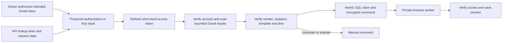

# Gmail API Access and Provider MFA Recovery

**Read an authorized inbox safely and use a narrowly checked verification message to recover a business connection.**

[Business problem](#the-business-problem) · [Solution](#the-solution) · [Conclusions](#why-direct-gmail-access) · [Proof](#proof-it-works) · [Commands](docs/COMMANDS.md)


## The Business Problem

A business-report connection could require an emailed verification code after its saved session stopped working. Staff then had to notice the failure and reconnect. A reliable helper needed to read the intended inbox, avoid old or competing messages and keep codes and credentials out of logs.

## The Solution

After an Azure custom-connector attempt failed during creation, use the direct Gmail API with the existing approved Google OAuth application. Keep authorization material in Azure Key Vault, check the actual mailbox before reading messages and bind each candidate to the active worker request. The full application verifies the message, claims it once, encrypts the command and saves the provider session only after protected access succeeds.

**Business outcome:** The platform gained a controlled recovery path with manual fallback rather than relying on repeated staff inbox checks or an unproven connector retry. This does not promise permanent provider sessions or unattended recovery from every failure.

## Architecture



The API owns lookup and request state; the worker owns provider navigation and session storage. This direct Gmail implementation does **not** depend on a deployed Logic App or Azure Gmail connector.

## What Was Built

| Component | Purpose | Code |
| --- | --- | --- |
| Actual bounded Google transport | Restrict endpoints, response size, redirects, deadlines, scope and mailbox identity | [Transport](src/gmailTransport.ts) |
| Actual request planner | Permit only a current, verified request with time and pagination limits | [Planner](src/mailbox/mailbox-plan.js) |
| Actual enumeration and selection | Finish bounded discovery, reject duplicate IDs and ambiguous or untrusted messages | [Enumeration](src/mailbox/enumerate-mail.js), [selection](src/mailbox/mailbox-candidate.js) |
| Actual timestamp repair | Accept only the exact overlapping whole-second arrival bucket | [Timing rule](src/mailbox/candidate-binding.js) |
| Actual cryptographic and persistence references | Verify raw email, read Key Vault, atomically claim and submit an encrypted command | [Verifier](reference/gmailMessage.ts), [lookup](reference/gmailLookup.ts), [store](reference/gmailLookupStore.ts) |
| Retained failed connector definition | Explain the attempted approach without activating it | [Historical Terraform](infra/connector-history/main.tf) |

## Why Direct Gmail Access?

The connector's public contract validated, but Azure resource creation still returned HTTP 500 before OAuth or mailbox reads. No actionable service root cause was established. A support request was accepted asynchronously and then failed eligibility checks; that was not an opened support case.

Direct API retrieval removed that connector dependency for MFA. It added responsibility for OAuth refresh, account checking, email parsing, message verification and ambiguity handling. The [original Logic Apps ingestion project](https://github.com/truthofsource/azure-logic-apps-document-ingestion) remains a separate workload. Shared Google project ancestry does not make connections, permissions or acceptance interchangeable.

## Proof It Works

### 1. Run local transport and selection checks

```bash
npm test
npm run demo
```

**Observed: 27 local code tests passed, with zero failures.** Tests use fake HTTP responses and fictional messages. They exercise actual transport and helper code without using a real Google account. They do not claim a fresh OAuth, DKIM, SQL or browser-worker acceptance test.


### 2. Review the difficult cases


Multiple fresh messages remain ambiguous, even when their codes match. Regular browser sign-ins can create competing emails. The code does not guess which one belongs to the worker.

### 3. Open the local reference

```bash
python -B scripts/preview.py --port 8141
```

Open [the local reference](http://127.0.0.1:8141). No real messages, codes, OAuth credentials or account data are displayed. [Validation](docs/VALIDATION.md) separates local checks from dated platform acceptance.

## Strengths, Weaknesses and Tradeoffs

| Choice | Strength | Limitation |
| --- | --- | --- |
| Direct Gmail API | Avoids the failed Azure connector dependency | The application must own token refresh and API failure handling |
| Read-only scope | Prevents message edits and sends through this authorization | The permission can still read the authorized mailbox broadly; application filters do not narrow the OAuth scope |
| Verified single candidate | Reduces stale-message and wrong-code selection | External emails lack a unique application request ID; some cases require manual help |
| One claim and encrypted command | Prevents reuse and keeps the code out of persisted plaintext | SQL state, leases and worker keys must remain consistent |
| Bounded attempts and fallback | Avoids resend loops and excessive sign-in attempts | Staff may still need to reconnect after an expired or failed attempt |

## Guides

- [Access, verification and identity boundaries](docs/IMPLEMENTATION.md)
- [Issues and conclusions](docs/ISSUES-AND-CONCLUSIONS.md)
- [Commands and clickops](docs/COMMANDS.md)
- [Operations, costs and scaling](docs/OPERATIONS-AND-SCALING.md)
- [Source map](docs/SOURCE-MAP.md)
- [Validation and evidence limits](docs/VALIDATION.md)

Identifying organization and provider labels are generalized. The historical connector stays Off; it is not part of the working direct-API dependency chain. Publication performs no Gmail reads, code requests, Azure starts or deployments. GitHub checks are manual-only.
